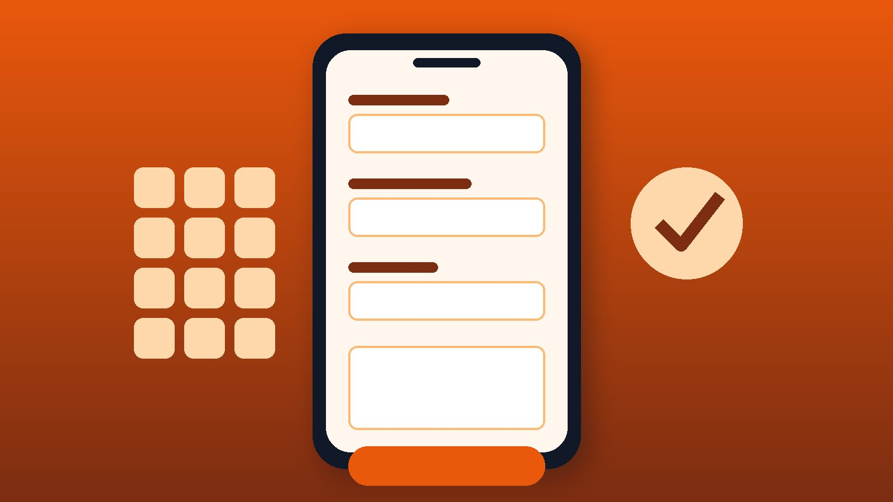

# 8 Cara Membuat Formulir Kontak Website yang Nyaman Diisi

| | |
|---|---|
| Status | **DRAF, belum terbit** |
| Kata kunci | formulir kontak |
| Kategori | umkm |
| Slug | cara-membuat-formulir-kontak-nyaman |
| Rencana terbit | 2026-11-23 07:00:00 |
| Judul SEO | 8 Cara Membuat Formulir Kontak Website yang Nyaman Diisi |
| Deskripsi SEO | Delapan cara membuat formulir kontak website usaha jasa yang nyaman diisi di ponsel: kolom secukupnya, label jelas, isian otomatis, dan pesan kesalahan jelas. |

**Ringkasan:** Calon pelanggan sudah siap meminta penawaran, lalu tertahan di formulir yang membingungkan. Delapan cara sederhana ini membantu minat mereka sampai ke kotak masuk Anda.

---

Bayangkan seorang calon pelanggan sudah membaca halaman layanan Anda sampai habis dan siap meminta penawaran. Ia membuka formulir kontak di ponselnya, lalu menemukan sebelas kolom wajib, papan ketik huruf yang muncul saat ia hendak mengetik nomor telepon, dan pesan "Terjadi kesalahan" tanpa penjelasan setelah menekan tombol kirim. Ia menghela napas dan berniat menghubungi nanti saja. Sering kali, nanti itu tidak pernah datang.

Bagi usaha jasa, formulir di website adalah pintu masuk prospek. Kabar baiknya, membuatnya nyaman diisi tidak membutuhkan teknologi yang rumit. Berikut delapan cara yang bisa langsung didiskusikan dengan pembuat website Anda.

**Daftar isi:**

1. [Mengapa formulir layak diperhatikan](#penting)
2. [Singkat dan jelas sejak kolom pertama](#singkat)
3. [Bantu ponsel bekerja untuk pengunjung](#ponsel)
4. [Pesan kesalahan yang menolong](#kesalahan)
5. [Setelah tombol kirim ditekan](#kirim)
6. [Menguji formulir sendiri](#uji)

## Mengapa Formulir Kontak Layak Diperhatikan

Pemilik usaha biasanya mencurahkan banyak waktu untuk foto, warna, dan tulisan di halaman utama. Formulir kontak sering dianggap bagian kecil di ujung halaman. Padahal, di sanalah minat pengunjung berubah menjadi percakapan bisnis. Setiap kolom yang membingungkan menjadi satu alasan tambahan bagi pengunjung untuk menunda.

Formulir juga sering menjadi kesan terakhir sebelum percakapan dimulai. Formulir yang tertata memberi sinyal bahwa usaha Anda mengelola pekerjaan dengan rapi, sedangkan formulir yang membingungkan bisa menimbulkan keraguan, meski layanan Anda sebenarnya sangat baik.

Delapan cara di bawah ini disusun dari pedoman teknis yang terbuka untuk umum, ditambah kebiasaan baik yang umum dipakai para pembuat website. Sebagian besar bisa diterapkan tanpa mengubah desain secara keseluruhan.

## Singkat dan Jelas Sejak Kolom Pertama

### 1. Minta data yang benar-benar dibutuhkan

Untuk permintaan penawaran awal, nama, nomor telepon atau alamat email, dan pesan singkat biasanya sudah cukup. Detail lain, seperti anggaran, jumlah karyawan, atau alamat lengkap, bisa ditanyakan pada percakapan pertama. Setiap kolom tambahan sebaiknya punya alasan yang jelas: apakah tim Anda memang memakainya untuk menanggapi pesan?

Bila Anda butuh informasi tambahan untuk menyaring prospek, pertimbangkan daftar pilihan singkat, misalnya jenis layanan yang diminati. Memilih dari daftar biasanya lebih cepat daripada mengetik, dan data yang masuk juga lebih rapi untuk dibaca tim penjualan.

### 2. Pasang label yang selalu terlihat

[Pedoman aksesibilitas konten web](https://www.w3.org/TR/WCAG22/) meminta label atau petunjuk tersedia ketika pengguna diminta memasukkan data. Teks samar di dalam kolom yang hilang begitu pengguna mulai mengetik bukan pengganti label, karena pengunjung bisa lupa kolom apa yang sedang diisinya. Tandai juga dengan jelas kolom yang wajib dan kolom yang boleh dikosongkan.

## Bantu Ponsel Bekerja untuk Pengunjung

### 3. Gunakan jenis kolom yang tepat

[Dokumentasi teknis kolom nomor telepon](https://developer.mozilla.org/en-US/docs/Web/HTML/Reference/Elements/Input/tel) menjelaskan bahwa kolom bertipe telepon membuat peramban di ponsel menampilkan papan ketik khusus untuk nomor telepon. [Dokumentasi kolom email](https://developer.mozilla.org/en-US/docs/Web/HTML/Reference/Elements/Input/email) juga menjelaskan bahwa kolom bertipe email otomatis diperiksa formatnya sebelum formulir bisa dikirim. Perubahan kecil di kode ini bisa menghemat banyak ketukan jari pengunjung.

### 4. Manfaatkan isian otomatis

[Panduan atribut isian otomatis](https://developer.mozilla.org/en-US/docs/Web/HTML/Reference/Attributes/autocomplete) menjelaskan bahwa atribut ini memberi petunjuk kepada peramban tentang jenis data yang diharapkan di setiap kolom, sehingga peramban bisa membantu mengisinya. Dengan begitu, nama, email, dan nomor telepon yang sudah tersimpan di perangkat pengunjung bisa terisi dengan sekali sentuh.

## Pesan Kesalahan yang Menolong

### 5. Jelaskan kesalahan dengan kalimat

Pedoman aksesibilitas yang sama meminta kolom yang keliru ditandai dan kesalahannya dijelaskan dalam bentuk teks. Kalimat "Alamat email belum lengkap, contoh: nama@example.com" jauh lebih menolong daripada "Input tidak valid". Hindari juga hanya mengubah warna kolom menjadi merah, karena pedoman tersebut meminta warna tidak dipakai sendirian sebagai penanda informasi.

### 6. Jangan hapus isian saat terjadi kesalahan

Mengetik ulang pesan panjang hanya karena satu kolom terlewat adalah pengalaman yang melelahkan. Isian yang sudah benar sebaiknya tetap tersimpan, dan halaman langsung mengarahkan pengunjung ke kolom yang perlu diperbaiki. Bila formulir cukup panjang, membaginya menjadi dua atau tiga langkah pendek dengan penanda kemajuan juga bisa membantu, asalkan pengunjung bisa kembali ke langkah sebelumnya tanpa kehilangan isian.

## Setelah Tombol Kirim Ditekan

### 7. Periksa ulang di server dan saring kiriman otomatis

Dokumentasi kolom email yang sama mengingatkan bahwa validasi di formulir HTML bukan pengganti pemeriksaan di sisi server, karena validasi di halaman mudah diubah atau dilewati. Untuk menahan kiriman otomatis yang tidak diinginkan, pilih cara yang ramah bagi manusia, seperti kolom jebakan tersembunyi atau pembatasan jumlah kiriman, sebelum memakai teka-teki gambar yang merepotkan pengunjung.

### 8. Beri kejelasan tentang langkah berikutnya

Tampilkan pesan terima kasih yang menjelaskan apa yang terjadi selanjutnya: kapan tim Anda akan menghubungi, lewat saluran apa, dan ke mana pengunjung bisa menghubungi bila mendesak. Kirim juga email konfirmasi berisi salinan pesannya. Periksa pula bahwa pesan yang masuk benar-benar sampai ke orang yang tepat, bukan tertumpuk di kotak masuk yang jarang dibuka.

Kecepatan tanggapan juga bagian dari pengalaman mengisi formulir. Tim yang membalas pada hari yang sama biasanya meninggalkan kesan lebih baik daripada tim yang membalas beberapa hari kemudian, serapi apa pun formulirnya. Tetapkan siapa yang bertugas memeriksa pesan masuk, termasuk saat hari libur atau ketika petugas utama sedang cuti.

## Menguji Formulir Kontak Anda Sendiri

Luangkan sepuluh menit minggu ini untuk mencoba formulir kontak di website usaha Anda dari ponsel:

1. Isi semua kolom dengan satu tangan.
2. Sengaja kosongkan satu kolom wajib, lalu baca pesan yang muncul.
3. Kirim formulir, kemudian catat berapa lama sampai pesan tiba di tim Anda.
4. Ulangi dari laptop hanya dengan keyboard, tanpa tetikus.

Jika website Anda belum punya formulir yang layak, atau Anda baru akan membuat website pertama, tim kami bisa membantu merancang formulir dengan prinsip-prinsip di atas melalui layanan [website untuk UMKM](/jasa-website-umkm).

## Kembali ke Calon Pelanggan Tadi

Putar ulang adegan pembuka. Calon pelanggan yang sama membuka formulir Anda. Hanya ada empat kolom dengan label yang jelas. Saat ia mengetik nomor telepon, papan ketik angka langsung muncul. Nama dan emailnya terisi otomatis. Ia lupa mengisi pesan, dan formulir memberi tahu dengan sopan tanpa menghapus isian lain. Setelah menekan tombol kirim, ia membaca bahwa tim Anda akan menghubunginya pada hari kerja yang sama. Dua menit, selesai.

Formulir yang nyaman bukan alasan orang tertarik pada layanan Anda; itu tugas halaman lain. Namun formulir yang nyaman membantu menjaga agar minat yang sudah tumbuh tidak hilang di langkah terakhir.

Pertanyaan untuk Anda: kapan terakhir kali seseorang di kantor mencoba mengisi formulir kontak website Anda sendiri dari ponsel?

Ingin formulir dan halaman kontak website Anda ditinjau? [Ajukan konsultasi gratis](/konsultasi), dan kami akan membahas bagian mana yang sebaiknya diperbaiki lebih dulu.

---

## Sumber dan lisensi

**Sumber angka dan fakta:**

- <https://developer.mozilla.org/en-US/docs/Web/HTML/Reference/Elements/Input/tel>: Kolom bertipe telepon menampilkan papan ketik khusus nomor telepon di peramban ponsel.
- <https://developer.mozilla.org/en-US/docs/Web/HTML/Reference/Elements/Input/email>: Kolom bertipe email divalidasi otomatis sebelum formulir dikirim; validasi HTML bukan pengganti pemeriksaan di sisi server.
- <https://developer.mozilla.org/en-US/docs/Web/HTML/Reference/Attributes/autocomplete>: Atribut isian otomatis memberi petunjuk jenis data yang diharapkan sehingga peramban dapat membantu mengisi.
- <https://www.w3.org/TR/WCAG22/>: Label atau petunjuk untuk masukan pengguna, identifikasi kesalahan dalam bentuk teks, warna tidak dipakai sendirian sebagai penanda.

**Gambar:** `public/images/blog/cara-membuat-formulir-kontak-nyaman.jpg`, ilustrasi buatan sendiri dengan skrip Python (Pillow), lisensi **Karya sendiri**, tercatat di `public/images/blog/LISENSI.csv`.
