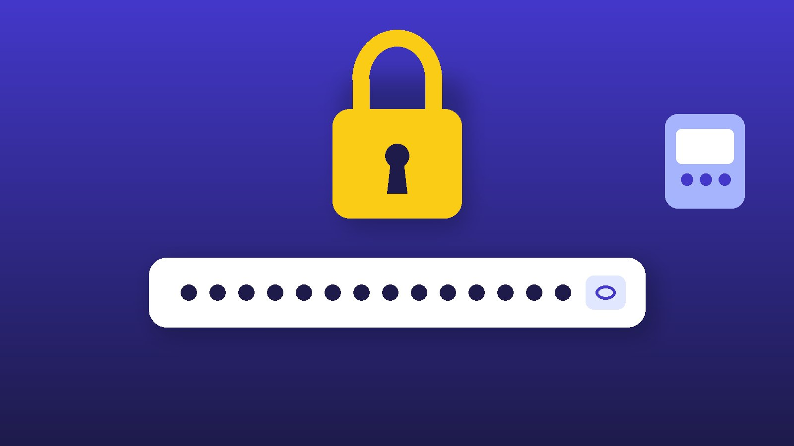

# 7 Pedoman Kebijakan Kata Sandi untuk Aplikasi Internal Perusahaan

| | |
|---|---|
| Status | **DRAF, belum terbit** |
| Kata kunci | kebijakan kata sandi |
| Kategori | custom-software |
| Slug | kebijakan-kata-sandi-aplikasi-perusahaan |
| Rencana terbit | 2026-11-23 07:00:00 |
| Judul SEO | 7 Pedoman Kebijakan Kata Sandi untuk Aplikasi Perusahaan |
| Deskripsi SEO | Tujuh pedoman kebijakan kata sandi untuk aplikasi internal: panjang minimal, tanpa aturan simbol, tanpa ganti berkala, daftar larangan, dan login berlapis. |

**Ringkasan:** Wajib simbol dan ganti tiap tiga bulan ternyata bukan lagi arah pedoman terbaru. Tujuh pedoman ini membantu login aplikasi kantor tetap aman sekaligus lebih ringan.

---

Bayangkan Senin pagi di kantor Anda. Sistem internal baru saja meminta semua karyawan mengganti kata sandi karena jadwal tiga bulanan sudah tiba. Bagian admin sibuk membuka akun yang terkunci, seorang manajer menempelkan catatan kecil berisi kata sandi barunya di bawah monitor, dan beberapa orang cukup mengganti angka di ujung kata sandi lama. Niatnya menjaga keamanan, tetapi hasilnya justru melelahkan semua orang. Di sinilah kebijakan kata sandi yang lebih tepat bisa membuat perbedaan.

Arah pedoman keamanan login sudah banyak berubah dalam beberapa tahun terakhir. Aturan yang dulu dianggap wajib kini justru disarankan untuk ditinggalkan, digantikan langkah yang lebih sederhana bagi pengguna. Artikel ini merangkum tujuh pedoman yang bisa Anda diskusikan dengan tim teknologi informasi atau vendor aplikasi.

**Daftar isi:**

1. [Mengapa perlu ditinjau ulang](#tinjau)
2. [Panjang, bukan kerumitan](#panjang)
3. [Tanpa aturan wajib simbol](#simbol)
4. [Tanpa ganti berkala](#berkala)
5. [Daftar kata sandi terlarang](#larangan)
6. [Batas percobaan login](#batas)
7. [Pengelola kata sandi](#pengelola)
8. [Login berlapis](#berlapis)

## Mengapa Kebijakan Kata Sandi Perlu Ditinjau Ulang

Banyak aturan yang kita kenal, seperti wajib huruf besar, angka, dan simbol, atau wajib ganti secara berkala, lahir dari niat baik. Namun [pedoman identitas digital dan autentikasi terbaru](https://pages.nist.gov/800-63-4/sp800-63b.html) yang diterbitkan sebuah lembaga standar teknologi mengambil arah yang berbeda. Lampiran pedoman tersebut menjelaskan bahwa analisis terhadap kumpulan kata sandi yang pernah bocor menunjukkan manfaat aturan komposisi ternyata tidak sebesar yang dulu diperkirakan.

Prinsip-prinsip dalam pedoman ini mudah diterapkan pada aplikasi internal perusahaan: portal karyawan, sistem gudang, aplikasi keuangan, atau dasbor penjualan. Berikut tujuh hal yang bisa dijadikan bahan pembaruan kebijakan di kantor Anda.

## 1. Utamakan Panjang, Bukan Kerumitan

Pedoman tersebut meminta kata sandi yang dipakai sebagai faktor login tunggal memiliki panjang minimal 15 karakter. Bila kata sandi hanya menjadi bagian dari login berlapis, batas bawahnya boleh lebih pendek, tetapi tetap minimal delapan karakter. Sistem juga dianjurkan menerima kata sandi sampai sekurang-kurangnya 64 karakter, termasuk karakter spasi.

Dengan batas panjang yang longgar, karyawan bisa memakai frasa yang terdiri dari beberapa kata acak. Frasa seperti itu biasanya lebih mudah diingat daripada kombinasi pendek yang rumit, sehingga godaan untuk menuliskannya di kertas ikut berkurang.

## 2. Hapus Aturan Wajib Simbol dan Huruf Besar

Pedoman yang sama menyatakan dengan tegas bahwa layanan tidak boleh memaksakan aturan komposisi lain, seperti kewajiban mencampur jenis karakter. Aturan seperti itu sering mendorong pola yang mudah ditebak: huruf besar di depan, angka dan tanda seru di belakang. Hasilnya terlihat rumit di mata manusia, tetapi belum tentu sulit diterka oleh program penebak kata sandi. Pesan yang lebih berguna di halaman pendaftaran adalah anjuran sederhana: pilih frasa panjang yang hanya Anda sendiri yang tahu.

## 3. Berhenti Memaksa Ganti Kata Sandi Berkala

Pedoman itu juga menyatakan bahwa pengguna tidak boleh diwajibkan mengganti kata sandi secara berkala. Penggantian tetap wajib dilakukan ketika ada bukti bahwa kata sandi telah bocor atau disalahgunakan. Perubahan ini biasanya mengurangi kebiasaan mengganti satu angka di ujung kata sandi lama, sekaligus meringankan beban tim admin yang setiap tiga bulan kebanjiran permintaan buka akun.

## 4. Tolak Kata Sandi yang Terlalu Umum

Sebagai pengganti aturan yang rumit, sistem diminta membandingkan setiap kata sandi baru dengan daftar kata sandi terlarang. Isinya antara lain kata sandi yang pernah bocor, kata-kata kamus, serta kata yang berkaitan dengan konteks, misalnya nama layanan atau nama pengguna itu sendiri. Bila kata sandi ditolak, sistem wajib menjelaskan alasannya dan memberi panduan agar pengguna bisa memilih yang lebih kuat.

Untuk aplikasi internal, daftar ini bisa ditambah dengan nama perusahaan, nama produk, dan nama kota tempat kantor berada. Langkah sederhana ini menutup jenis tebakan yang biasanya dicoba lebih dulu.

## 5. Batasi Percobaan Login yang Gagal

Pedoman tersebut mewajibkan pembatasan jumlah percobaan login yang gagal. Batas atasnya adalah 100 kali gagal berturut-turut pada satu akun, setelah itu metode login tersebut dinonaktifkan. Angka itu merupakan batas maksimal, dan organisasi boleh menetapkan batas yang lebih rendah. Pedoman yang sama juga menyebut teknik tambahan untuk mengurangi kemungkinan pemilik akun yang sah ikut terkunci.

Bagi pengguna yang sah, aturan ini hampir tidak terasa. Bagi pihak yang mencoba menebak kata sandi satu per satu, ruang geraknya menjadi sangat sempit.

Dalam aplikasi internal, pembatasan ini sebaiknya disertai catatan yang bisa dibaca tim admin: akun mana yang sering gagal login, dari perangkat apa, dan pada jam berapa. Catatan seperti ini membantu membedakan karyawan yang sekadar lupa kata sandi dari upaya tebakan yang perlu ditindaklanjuti, tanpa harus menunggu laporan dari pengguna.

## 6. Izinkan Pengelola Kata Sandi dan Fitur Tempel

Banyak sistem lama melarang fitur tempel di kolom kata sandi. Pedoman terbaru justru mewajibkan sistem mengizinkan pengelola kata sandi dan pengisian otomatis, serta menganjurkan fitur tempel tetap aktif. Menurut pedoman tersebut, pemakaian pengelola kata sandi meningkatkan kemungkinan pengguna memilih kata sandi yang lebih kuat, terutama bila dilengkapi pembuat kata sandi.

Ada beberapa anjuran kecil lain yang layak dicontoh. Sediakan pilihan untuk menampilkan kata sandi saat diketik, agar pengguna bisa memastikan ketikannya benar. Jangan simpan petunjuk kata sandi yang bisa dilihat orang lain, dan jangan meminta pertanyaan keamanan seperti nama hewan peliharaan pertama.

## 7. Lengkapi Kebijakan Kata Sandi dengan Login Berlapis

Kata sandi yang baik menjadi lebih kuat bila didampingi faktor kedua, misalnya kode dari aplikasi autentikator atau kunci keamanan fisik. Untuk akun dengan akses luas, seperti admin sistem, bagian keuangan, dan jajaran direksi, login berlapis sebaiknya menjadi standar, bukan pilihan.

Saat membangun aplikasi internal, fitur ini lebih mudah disiapkan sejak awal daripada ditambahkan belakangan. Karena itu, desain alur login sebaiknya dibahas di tahap perencanaan proyek [software custom](/jasa-software-custom), bersama pembagian peran dan hak akses setiap karyawan.

## Senin Pagi yang Berbeda

Putar ulang adegan di awal. Tidak ada lagi pengingat ganti kata sandi tiga bulanan. Karyawan memakai frasa panjang yang mereka ingat, atau pengelola kata sandi yang mengisinya secara otomatis. Akun direksi dan keuangan dilindungi faktor kedua. Bagian admin tidak lagi menghabiskan pagi untuk membuka akun yang terkunci, dan catatan kecil di bawah monitor sudah tidak diperlukan.

Keamanan yang baik tidak harus terasa menyulitkan. Kebijakan yang masuk akal lebih mudah dipatuhi, dan kebijakan yang benar-benar dipatuhi itulah yang melindungi data perusahaan sehari-hari.

Pertanyaan untuk diuji di kantor Anda: buka halaman ganti kata sandi di sistem internal perusahaan, lalu coba masukkan frasa 20 karakter yang mengandung spasi, atau tempelkan kata sandi dari pengelola kata sandi. Apakah sistem Anda menerimanya?

Bila Anda ingin meninjau kebijakan kata sandi dan alur login aplikasi perusahaan, atau sedang merencanakan sistem baru dengan keamanan yang dirancang sejak awal, [jadwalkan konsultasi gratis](/konsultasi) dengan tim kami. Sebagai bahan diskusi internal, Anda juga bisa membaca [panduan keamanan website perusahaan](/blog/keamanan-website-perusahaan).

---

## Sumber dan lisensi

**Sumber angka dan fakta:**

- <https://pages.nist.gov/800-63-4/sp800-63b.html>: Pedoman identitas digital (autentikasi) revisi 4: minimal 15 karakter bila satu faktor, minimal 8 bila bagian dari login berlapis, maksimal sekurang-kurangnya 64, tanpa aturan komposisi, tanpa ganti berkala kecuali ada bukti bocor, daftar larangan, batas 100 percobaan gagal, izinkan pengelola kata sandi dan tempel, opsi tampilkan kata sandi, tanpa petunjuk dan pertanyaan keamanan; lampiran tentang manfaat aturan komposisi.

**Gambar:** `public/images/blog/kebijakan-kata-sandi-aplikasi-perusahaan.jpg`, ilustrasi buatan sendiri dengan skrip Python (Pillow), lisensi **Karya sendiri**, tercatat di `public/images/blog/LISENSI.csv`.
