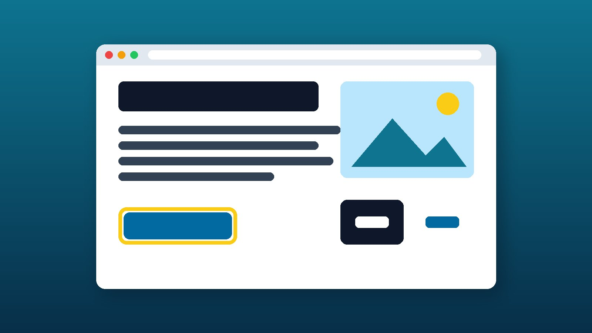

# 6 Langkah Meningkatkan Aksesibilitas Website Perusahaan

| | |
|---|---|
| Status | **DRAF, belum terbit** |
| Kata kunci | aksesibilitas website |
| Kategori | tips-website |
| Slug | langkah-aksesibilitas-website-perusahaan |
| Rencana terbit | 2026-11-23 07:00:00 |
| Judul SEO | 6 Langkah Meningkatkan Aksesibilitas Website Perusahaan |
| Deskripsi SEO | Panduan aksesibilitas website untuk perusahaan: kontras teks, teks pengganti gambar, navigasi keyboard, ukuran tombol, formulir, dan perawatan rutin. |

**Ringkasan:** Teks yang sulit dibaca dan tombol yang terlalu kecil diam-diam membuat calon klien menutup halaman. Enam langkah ini membantu website Anda nyaman dipakai siapa saja.

---

Bayangkan seorang calon klien membuka website perusahaan Anda dari ponsel di ruang tunggu sebuah kantor. Lampu ruangan terang, teks abu-abu tipis di atas latar putih sulit terbaca, dan tombol "Hubungi Kami" begitu kecil sehingga jarinya dua kali meleset. Ia menutup halaman dan beralih ke tab lain. Tidak ada yang kurang dari layanan Anda; yang menghalanginya adalah aksesibilitas website, yaitu seberapa mudah halaman Anda dipakai oleh siapa saja, dalam kondisi apa saja.

Kabar baiknya, perbaikan aksesibilitas bukan proyek raksasa. Sebagian besar langkahnya sederhana: warna yang cukup kontras, teks pengganti untuk gambar, tombol yang cukup besar, dan formulir yang bisa diisi tanpa tetikus. Artikel ini membahas enam langkah yang bisa dibicarakan manajemen dengan tim internal atau vendor website secara terukur.

**Daftar isi:**

1. [Arti aksesibilitas bagi perusahaan](#arti)
2. [Teks yang mudah dibaca](#kontras)
3. [Teks pengganti gambar](#gambar)
4. [Navigasi dengan keyboard](#keyboard)
5. [Area sentuh dan warna](#sentuh)
6. [Formulir dan pesan kesalahan](#formulir)
7. [Perawatan rutin](#rutin)
8. [Pertanyaan dari manajemen](#tanya)

## Apa Arti Aksesibilitas Website bagi Perusahaan

Aksesibilitas sering dianggap hanya urusan pengguna penyandang disabilitas. Itu bagian yang penting dan sudah sepantasnya dihormati. Namun dalam keseharian, manfaatnya terasa jauh lebih luas: orang tua yang penglihatannya mulai berkurang, karyawan yang membuka website di bawah terik matahari, tamu yang memakai koneksi lambat, atau siapa saja yang sedang memegang ponsel dengan satu tangan sambil membawa tas.

Acuan yang banyak dirujuk untuk urusan ini adalah [pedoman aksesibilitas konten web versi 2.2](https://www.w3.org/TR/WCAG22/). Dokumen tersebut menyebut bahwa mengikuti pedoman ini membuat konten lebih mudah diakses oleh beragam penyandang disabilitas, dan sering kali juga membuat konten lebih mudah dipakai oleh pengguna pada umumnya. Pedoman ini berlaku untuk berbagai perangkat, dari komputer meja, laptop, kios layar sentuh, sampai ponsel.

Pedoman itu berdiri di atas empat prinsip: konten harus dapat dipersepsi, dapat dioperasikan, dapat dipahami, dan andal ketika dibuka dengan beragam perangkat serta teknologi bantu. Setiap prinsip diturunkan menjadi kriteria yang bisa diuji, dengan tiga tingkat kesesuaian: A sebagai tingkat paling dasar, AA, dan AAA sebagai tingkat tertinggi. Untuk website perusahaan, tingkat AA biasanya dipilih sebagai sasaran yang realistis.

## Langkah 1: Pastikan Teks Mudah Dibaca

Kriteria kontras minimum dalam pedoman tersebut meminta rasio kontras paling sedikit 4,5:1 antara teks dan latarnya, serta 3:1 untuk teks berukuran besar. Teks yang menjadi bagian dari logo dikecualikan. Angka ini bukan soal selera desain, melainkan ukuran yang bisa dicek dengan alat pemeriksa kontras yang mudah ditemukan.

Kriteria lain meminta teks dapat diperbesar sampai 200 persen tanpa kehilangan isi atau fungsi. Artinya, ketika pengunjung memperbesar tampilan, menu tidak boleh saling menumpuk dan tombol tidak boleh hilang dari layar. Bagian ini sering luput diuji karena tim desain biasanya melihat website pada ukuran standar.

Satu kebiasaan kecil yang banyak membantu: hindari menaruh teks penting di dalam gambar. Teks di dalam gambar tidak ikut membesar dengan rapi, tidak bisa dibacakan oleh pembaca layar, dan menyulitkan mesin pencari memahami isi halaman.

## Langkah 2: Beri Teks Pengganti pada Gambar

Pedoman yang sama meminta setiap konten nonteks memiliki alternatif berupa teks dengan tujuan yang setara. Bagi pengguna pembaca layar, foto tim, bagan alur kerja, atau ikon layanan tanpa teks pengganti hanyalah ruang kosong.

Teks pengganti yang baik menjelaskan fungsi gambar, bukan sekadar menyebut "gambar". Untuk foto di halaman layanan logistik, misalnya, tuliskan apa yang ingin ditunjukkan: "Petugas memindai label palet di rak penyimpanan". Untuk gambar yang murni hiasan, teks pengganti boleh dikosongkan agar pembaca layar tidak membacakan hal yang tidak perlu.

Video profil perusahaan juga sebaiknya dilengkapi takarir. Selain membantu pengguna dengan gangguan pendengaran, takarir menolong siapa saja yang menonton tanpa suara di kantor atau di perjalanan.

## Langkah 3: Uji Navigasi dengan Keyboard

Salah satu kriteria tingkat dasar meminta seluruh fungsi konten dapat dioperasikan lewat keyboard. Sebagian orang mengandalkan keyboard atau perangkat yang bekerja seperti keyboard, misalnya karena keterbatasan gerak tangan.

Ujiannya sederhana dan bisa dilakukan oleh manajer mana pun. Buka website Anda, singkirkan tetikus, lalu tekan tombol Tab berulang kali. Apakah Anda bisa melihat elemen mana yang sedang aktif? Apakah menu turun bisa dibuka? Apakah formulir permintaan penawaran bisa diisi dan dikirim sampai selesai? Jika di tengah jalan penanda fokus menghilang, itu tanda ada bagian yang perlu dibenahi.

## Langkah 4: Perbesar Area Sentuh dan Jangan Hanya Mengandalkan Warna

Versi 2.2 menambahkan kriteria ukuran target minimum: area yang diklik atau disentuh paling sedikit 24 kali 24 piksel CSS, atau diberi jarak yang cukup dari target lain. Ikon kecil yang berdempetan, seperti deretan ikon di kaki halaman, sering menjadi sumber salah sentuh di ponsel.

Pedoman tersebut juga meminta warna tidak dipakai sendirian untuk menyampaikan informasi. Formulir yang hanya mengubah garis kolom menjadi merah saat terjadi kesalahan akan menyulitkan orang yang sulit membedakan warna. Tambahkan pesan teks yang jelas, misalnya "Nomor telepon belum diisi".

## Langkah 5: Rapikan Formulir dan Pesan Kesalahan

Formulir adalah titik ketika pengunjung berubah menjadi prospek, jadi bagian ini layak mendapat perhatian lebih. Pedoman yang sama meminta label atau petunjuk tersedia ketika pengguna diminta memasukkan data. Bila kesalahan input terdeteksi secara otomatis, kolom yang keliru perlu ditandai dan kesalahannya dijelaskan dalam bentuk teks.

Dalam praktik, setiap kolom sebaiknya punya label yang tetap terlihat, bukan hanya teks samar di dalam kolom yang hilang begitu pengguna mulai mengetik. Pesan kesalahan muncul di dekat kolom yang keliru dan menjelaskan cara memperbaikinya. Bila website Anda dibangun ulang, hal-hal ini sebaiknya masuk ke daftar kebutuhan sejak awal, misalnya saat merencanakan proyek [pengembangan website](/jasa-web-development).

## Langkah 6: Jadikan Aksesibilitas Website Bagian dari Perawatan Rutin

Aksesibilitas website bukan pekerjaan sekali jadi. Setiap kali ada halaman baru, banner promosi, atau gambar yang diunggah tim pemasaran, ada peluang muncul hambatan baru. Karena itu, pemeriksaan sederhana sebaiknya masuk ke daftar [perawatan website](/blog/maintenance-website-perusahaan) bulanan, berdampingan dengan pembaruan sistem dan pencadangan data.

Alat pemeriksa otomatis membantu menemukan kekurangan yang jelas, seperti kontras rendah atau gambar tanpa teks pengganti. Namun pedoman tersebut sendiri dirancang untuk diuji dengan kombinasi pengujian otomatis dan evaluasi manusia. Sesekali, mintalah rekan di luar tim desain mencoba website Anda dengan keyboard atau dengan tampilan diperbesar. Mereka sering menemukan hal yang tidak terlihat oleh pembuatnya.

## Pertanyaan yang Sering Diajukan Manajemen

### Apakah perbaikan aksesibilitas berarti mendesain ulang website?

Biasanya tidak. Banyak perbaikan bisa dilakukan pada website yang sudah berjalan: menyesuaikan warna, menambah teks pengganti, memperbaiki label formulir, dan memperbesar tombol. Desain ulang baru perlu dipertimbangkan bila struktur halamannya memang sulit diubah. Untuk keadaan seperti itu, panduan [redesign website](/blog/redesign-website-tanpa-kehilangan-trafik) kami bisa membantu menyusun langkahnya.

### Siapa yang sebaiknya bertanggung jawab?

Pengembang menangani sisi teknis, tetapi penulis konten dan tim pemasaran memegang peran yang sama besar karena merekalah yang menambah gambar, video, dan halaman baru. Pedoman singkat internal, misalnya "setiap gambar wajib punya teks pengganti", sering lebih efektif daripada pemeriksaan besar setahun sekali.

## Kembali ke Ruang Tunggu Itu

Sekarang putar ulang adegan di awal. Calon klien yang sama membuka website Anda di ruang tunggu yang terang. Teksnya cukup kontras untuk dibaca tanpa memicingkan mata. Tombol "Hubungi Kami" cukup besar untuk disentuh sekali. Formulir permintaan penawaran memberi tahu dengan sopan kolom mana yang belum lengkap. Ia mengirimkan pesannya sebelum namanya dipanggil.

Perubahan seperti ini jarang terlihat dramatis, tetapi terasa oleh setiap pengunjung. Website yang nyaman dipakai juga menyampaikan pesan halus tentang perusahaan Anda: teliti, peduli pada detail, dan menghargai waktu orang lain.

Coba uji sendiri hari ini: buka halaman layanan utama perusahaan Anda, singkirkan tetikus, lalu coba kirim formulir kontak hanya dengan keyboard. Berapa langkah yang bisa Anda selesaikan tanpa hambatan?

Jika Anda ingin aksesibilitas website perusahaan diperiksa dan dibenahi secara menyeluruh, tim kami siap membantu dari pemeriksaan awal sampai perbaikan. [Jadwalkan konsultasi gratis](/konsultasi) untuk membahas kondisi website Anda saat ini.

---

## Sumber dan lisensi

**Sumber angka dan fakta:**

- <https://www.w3.org/TR/WCAG22/>: Pedoman aksesibilitas konten web 2.2: empat prinsip, tingkat A/AA/AAA, kontras 4,5:1 dan 3:1, teks dapat diperbesar 200 persen, ukuran target 24x24 piksel CSS, keyboard, teks pengganti, warna tidak dipakai sendirian sebagai penanda, label dan identifikasi kesalahan, pengujian otomatis plus evaluasi manusia.

**Gambar:** `public/images/blog/langkah-aksesibilitas-website-perusahaan.jpg`, ilustrasi buatan sendiri dengan skrip Python (Pillow), lisensi **Karya sendiri**, tercatat di `public/images/blog/LISENSI.csv`.
