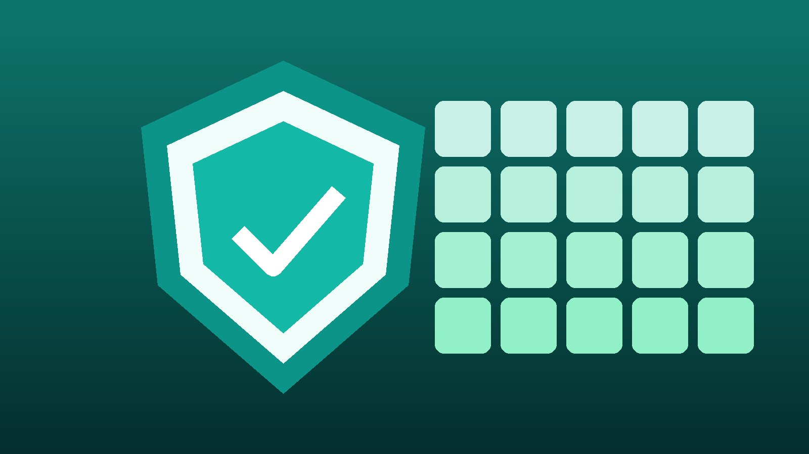

# 10 Risiko Keamanan Aplikasi Web yang Perlu Dibahas Sejak Perencanaan

| | |
|---|---|
| Status | **DRAF, belum terbit** |
| Kata kunci | keamanan aplikasi web |
| Kategori | custom-software |
| Slug | risiko-keamanan-aplikasi-web |
| Rencana terbit | 2026-11-23 07:00:00 |
| Judul SEO | 10 Risiko Keamanan Aplikasi Web untuk Dibahas Sejak Awal |
| Deskripsi SEO | Sepuluh kategori risiko keamanan aplikasi web dalam bahasa sehari-hari, lengkap dengan pertanyaan untuk tim pengembang dan cara memasukkannya ke rencana proyek. |

**Ringkasan:** Keamanan paling ringan dibangun saat aplikasi masih berupa rancangan. Kenali sepuluh kategori risiko dan pertanyaan sederhana untuk tim pengembang Anda.

---

Bayangkan rapat perencanaan aplikasi baru di perusahaan Anda. Daftar fitur sudah panjang: dasbor penjualan, persetujuan pengeluaran, laporan bulanan untuk direksi. Lalu seseorang bertanya, "Bagaimana dengan keamanan aplikasi web ini?" Ruangan mendadak hening, dan topik itu disepakati untuk dibahas nanti. Padahal, keamanan biasanya lebih mudah dan lebih hemat dibangun ketika aplikasi masih berupa rancangan di atas kertas.

Anda tidak perlu menjadi ahli untuk memimpin pembicaraan ini. Cukup memahami peta risikonya, lalu memastikan tim pengembang punya jawaban yang jelas untuk setiap bagian. Artikel ini menerjemahkan peta tersebut ke bahasa sehari-hari.

**Daftar isi:**

1. [Peta risiko dari komunitas terbuka](#peta)
2. [Hak akses dan konfigurasi](#akses)
3. [Data, masukan, dan rancangan](#data)
4. [Login, integritas, dan pemantauan](#login)
5. [Memasukkan keamanan ke rencana proyek](#rencana)
6. [Rapat yang sama, arah berbeda](#ulang)

## Peta Risiko Keamanan Aplikasi Web dari Komunitas Terbuka

Acuan yang biasanya dipakai pengembang untuk membahas topik ini adalah [daftar sepuluh risiko keamanan aplikasi web edisi 2025](https://owasp.org/Top10/2025/) yang disusun sebuah komunitas keamanan aplikasi terbuka. Edisi ini merupakan edisi kedelapan. Penyusunnya menggabungkan data hasil pengujian aplikasi dengan survei komunitas: delapan kategori dipilih berdasarkan data, dan dua lainnya berdasarkan suara para praktisi. Alasannya, data pengujian pada dasarnya selalu melihat ke masa lalu, sementara praktisi di lapangan sering lebih dulu melihat kecenderungan baru.

Daftar ini bukan daftar periksa yang lengkap, melainkan pengingat tentang area yang dinilai paling kritis oleh penyusunnya. Berikut kesepuluh kategorinya, masing-masing dengan satu pertanyaan yang bisa Anda ajukan kepada tim.

Bagi manajemen, nilai terbesar daftar ini adalah bahasa bersama. Ketika semua pihak merujuk ke peta yang sama, diskusi tentang keamanan tidak lagi bergantung pada istilah teknis yang sulit diikuti. Tim pengembang bisa menunjukkan kategori mana yang sudah ditangani, mana yang masih direncanakan, dan mana yang memerlukan anggaran tambahan, sehingga keputusan bisa diambil dengan informasi yang jelas.

## Hak Akses dan Konfigurasi

### 1. Kontrol akses yang longgar

Kategori ini tetap berada di urutan pertama. Contoh sederhananya, karyawan bagian gudang bisa membuka laporan keuangan hanya dengan mengubah alamat halaman di peramban. Pertanyaan untuk tim: apakah hak akses setiap halaman dan setiap data diperiksa di sisi server, bukan hanya disembunyikan dari menu?

### 2. Konfigurasi keamanan yang keliru

Kategori ini naik dari urutan kelima pada edisi 2021 ke urutan kedua. Menurut penyusunnya, hal ini sejalan dengan makin banyaknya perilaku aplikasi yang diatur lewat konfigurasi. Contohnya halaman pengaturan bawaan yang lupa ditutup, atau pesan galat yang menampilkan detail server. Pertanyaan: apakah ada daftar pengaturan standar untuk server produksi?

### 3. Kegagalan rantai pasok perangkat lunak

Aplikasi modern dibangun dari banyak pustaka dan komponen pihak ketiga. Kategori ini memperluas risiko komponen yang usang menjadi seluruh rantai ketergantungan, proses pembuatan, dan jalur distribusi perangkat lunak. Pertanyaan: siapa yang memantau pembaruan komponen, dan seberapa sering?

## Data, Masukan, dan Rancangan

### 4. Kegagalan kriptografi

Kata sandi perlu disimpan dalam bentuk hash yang aman, sedangkan data pelanggan dan dokumen keuangan perlu dienkripsi dengan benar, baik saat dikirim maupun saat disimpan. Penyusun daftar mencatat bahwa kategori ini sering berujung pada terbukanya data sensitif. Pertanyaan: data apa saja yang dienkripsi, dan di mana kuncinya disimpan?

### 5. Injeksi

Celah ini muncul ketika masukan pengguna diperlakukan sebagai perintah, misalnya lewat kolom pencarian atau formulir. Cakupannya beragam, dari skrip lintas situs sampai injeksi ke basis data. Pertanyaan: apakah semua masukan divalidasi, dan apakah kueri basis data memakai parameter?

### 6. Rancangan yang tidak aman

Sebagian risiko tidak bisa ditambal dengan kode yang rapi karena sumbernya ada pada rancangan alur. Misalnya, alur persetujuan pengeluaran yang memungkinkan seseorang menyetujui pengajuannya sendiri. Penyusun daftar mencatat adanya perbaikan di industri seiring makin banyaknya tim yang melakukan pemodelan ancaman sejak tahap rancangan. Pertanyaan: apakah alur-alur penting sudah ditinjau dari sudut pandang orang yang mungkin ingin menyalahgunakannya?

## Login, Integritas, dan Pemantauan

### 7. Kegagalan autentikasi

Kategori ini mencakup login yang mudah ditebak, sesi yang tidak pernah berakhir, dan pemulihan akun yang lemah. Penyusunnya mencatat bahwa makin luasnya pemakaian kerangka autentikasi yang terstandar tampaknya membawa dampak positif. Pedoman login yang lebih modern kami bahas dalam [artikel tentang kebijakan kata sandi](/blog/kebijakan-kata-sandi-aplikasi-perusahaan).

### 8. Kegagalan integritas perangkat lunak atau data

Kategori ini berkaitan dengan memastikan kode, pembaruan, dan data yang dipakai aplikasi benar-benar berasal dari sumber tepercaya dan tidak diubah di tengah jalan. Pertanyaan: bagaimana setiap pembaruan aplikasi diperiksa sebelum dipasang? Untuk aplikasi kecil sekalipun, kebiasaan sederhana seperti memasang pembaruan hanya dari sumber resmi sudah banyak membantu.

### 9. Kegagalan pencatatan dan peringatan keamanan

Nama kategori ini kini menekankan peringatan. Penyusunnya menyebut bahwa pencatatan yang baik tanpa peringatan nilainya kecil untuk mengenali insiden. Pertanyaan: jika ada percobaan login mencurigakan pukul dua pagi, siapa yang diberi tahu?

### 10. Penanganan kondisi tidak normal

Ini kategori baru pada edisi 2025. Fokusnya pada penanganan galat yang keliru, kesalahan logika, dan sistem yang justru membuka akses ketika terjadi gangguan. Contohnya, proses pembayaran yang tetap dicatat berhasil ketika sambungan ke layanan pembayaran terputus. Pertanyaan: apa yang dilakukan aplikasi ketika layanan pendukungnya tidak merespons?

## Cara Memasukkan Keamanan Aplikasi Web ke Rencana Proyek

Peta sepuluh risiko ini paling berguna bila diubah menjadi kebiasaan kerja, bukan dokumen yang disimpan di lemari. Beberapa langkah berikut biasanya efektif:

- **Tulis kebutuhan keamanan bersama kebutuhan fitur.** Misalnya, "hanya kepala divisi yang bisa menyetujui pengeluaran di atas batas tertentu".
- **Tentukan peran dan hak akses sejak awal.** Tabel sederhana berisi peran dan halaman yang boleh dibuka sudah sangat membantu.
- **Sediakan waktu untuk pengujian keamanan** sebelum aplikasi dipakai seluruh karyawan.
- **Sepakati siapa yang merawat aplikasi** setelah serah terima, termasuk pembaruan komponen.

Langkah-langkah ini juga memudahkan Anda membandingkan penawaran. Vendor yang terbiasa dengan peta risiko ini biasanya bisa menjelaskan pendekatannya dengan bahasa yang mudah dipahami manajemen. Panduan [memilih vendor](/blog/memilih-vendor-website) kami bisa menjadi pelengkap saat menilai calon mitra.

## Rapat yang Sama, Arah yang Berbeda

Kembali ke rapat perencanaan tadi. Kali ini, ketika pertanyaan tentang keamanan aplikasi web muncul, tim sudah punya jawaban: tabel hak akses terlampir, enkripsi data pelanggan sudah dijelaskan, peringatan login mencurigakan dikirim ke petugas jaga, dan jadwal pembaruan komponen sudah disepakati. Rapat berlanjut ke topik berikutnya dengan tenang.

Pekerjaan menjaga keamanan memang tidak pernah benar-benar selesai, tetapi rancangan yang matang membuat langkah-langkah berikutnya terasa jauh lebih ringan.

Untuk diuji di kantor Anda: ambil satu aplikasi internal yang sudah berjalan, lalu ajukan pertanyaan pertama dan kesembilan kepada tim pengelolanya. Seberapa cepat mereka bisa menjawab?

Jika Anda sedang merencanakan aplikasi baru atau ingin meninjau aplikasi yang sudah ada, tim [software custom](/jasa-software-custom) kami bisa membantu memetakan risikonya sejak tahap rancangan. [Jadwalkan konsultasi gratis](/konsultasi) untuk memulai pembicaraan.

---

## Sumber dan lisensi

**Sumber angka dan fakta:**

- <https://owasp.org/Top10/2025/>: Daftar sepuluh risiko keamanan aplikasi web edisi 2025 (edisi ke-8): urutan kategori, konfigurasi naik dari #5 (2021) ke #2, delapan kategori dari data dan dua dari survei, rantai pasok sebagai perluasan komponen usang, kategori baru penanganan kondisi tidak normal, catatan tentang pemodelan ancaman, kerangka autentikasi, dan peringatan.

**Gambar:** `public/images/blog/risiko-keamanan-aplikasi-web.jpg`, ilustrasi buatan sendiri dengan skrip Python (Pillow), lisensi **Karya sendiri**, tercatat di `public/images/blog/LISENSI.csv`.
